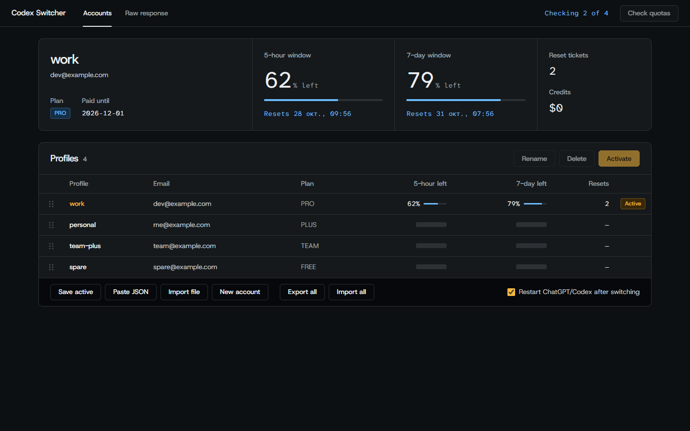

[Русский](README_RU.md) | **English**

# Codex Switcher

Desktop profile manager for Codex / ChatGPT: switch accounts via `~/.codex/auth.json`, see each account's live usage (5-hour and 7-day windows, reset tickets, credits), import profiles by paste or file, reorder them by drag and drop, and export or import every account at once (ZIP or JSON bundle). All app data lives in one folder, `~/.codex/codex-switcher/` (legacy `~/.codex/profiles` is migrated automatically).

Built with [Tauri 2](https://tauri.app): a Rust backend and a TypeScript + Vite UI. Runs on Windows, macOS and Linux.



## Installation

Download a build from [Releases](../../releases):

| File | Platform |
|---|---|
| `Codex Switcher_x.y.z_x64-setup.exe` / `.msi` | Windows 10/11 |
| `Codex Switcher_x.y.z_aarch64.dmg` | macOS Apple Silicon |
| `Codex Switcher_x.y.z_x64.dmg` | macOS Intel |
| `.AppImage` / `.deb` / `.rpm` | Linux x64 |

**Upgrading from 0.1.x:** the old installer is a different app to Windows, so the new one installs alongside it. Uninstall the old "Codex Switcher" from Settings, Apps; your profiles stay, since both versions use `~/.codex/codex-switcher/`.

**Windows:** the build is not code-signed, so SmartScreen may warn on first run: choose "More info", then "Run anyway".

**macOS:** builds are ad-hoc signed (not notarized). On first launch: right-click the app, then "Open", or run
`xattr -cr "/Applications/Codex Switcher.app"`.

## Features

- The active account up top: its 5-hour and 7-day windows as large readings, reset times, plan, reset tickets and credits
- Profiles table with live quotas for every saved account; quotas are checked on start and with **Check quotas**
- **Activate** (or double-click / Enter on a row) copies the profile to `auth.json` (the old one goes to `auth.json.bak`) and optionally restarts ChatGPT/Codex
- **New account**: removes the active `auth.json` (a copy goes to `auth.json.bak`), restarts ChatGPT/Codex for a fresh login; then **Save active** stores it as a profile
- Import a single profile: **Paste JSON** (the account is detected as you paste) or **Import file**
- **Export all / Import all**: ZIP (one file per profile plus `profiles_order.json`) or a JSON bundle; on import you pick which existing profiles to overwrite
- Reorder by dragging the handle, or with Alt+Up / Alt+Down; F2 renames, Delete removes
- **Raw response** tab with the last usage JSON for the active account
- Expired access tokens are refreshed automatically; the refreshed tokens are written to both `auth.json` and its saved profile so the two stay in sync

### How the restart works

| OS | What happens |
|---|---|
| Windows | ChatGPT/Codex are closed and the Codex (or ChatGPT) app is launched again from the Start menu |
| macOS | ChatGPT and Codex, if running, are asked to quit, given up to 5 s (then force-closed), and reopened once they have exited |
| Linux | Running ChatGPT/Codex processes are closed; start them again yourself |

Processes are matched by their exact name, so Codex Switcher and the `codex` CLI are never closed.

## Storage

- `~/.codex/auth.json`: active account (shared with Codex CLI)
- `~/.codex/codex-switcher/profiles/*.json`: saved profiles
- `~/.codex/codex-switcher/profiles_order.json`: custom order

## Run from source

Requirements: [Node.js](https://nodejs.org) 20+, [Rust](https://rustup.rs) stable, and the [Tauri prerequisites](https://tauri.app/start/prerequisites/) for your OS (WebView2 on Windows, Xcode CLT on macOS, `libwebkit2gtk-4.1-dev` on Linux).

```bash
npm install
npm run tauri dev     # run the app
npm run tauri build   # build installers into src-tauri/target/release/bundle
```

`npm run dev` alone serves the UI at http://localhost:1420 with mock data, for working on the interface in a browser.

## CI / CD

`.github/workflows/build.yml` runs on every push and pull request: lint (rustfmt, clippy), Rust tests and a UI type check, then bundles for Windows, macOS (arm64 and Intel) and Linux and uploads them as workflow artifacts. Pushing a `v*` tag sets the version from the tag and publishes a GitHub Release with all installers:

```bash
git tag v0.2.0 && git push origin v0.2.0
```
